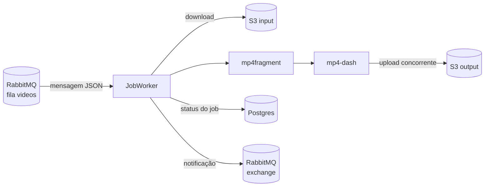

# Go Video Encoder

Worker em Go que converte vídeos MP4 para **MPEG-DASH**, o formato usado em streaming adaptativo. Ele consome pedidos de uma fila RabbitMQ, baixa o vídeo do S3, fragmenta e gera os segmentos DASH com o [Bento4](https://www.bento4.com/), sobe o resultado para outro bucket S3 e publica o status do job de volta no RabbitMQ.

Com o vídeo em DASH, o player começa a tocar sem baixar o arquivo inteiro e troca de qualidade conforme a banda disponível. Os segmentos também podem ser servidos por qualquer CDN.

## Fluxo



Cada mensagem vira um `Job`, que passa pelos status:

`STARTING` → `DOWNLOADING` → `FRAGMENTING` → `ENCODING` → `UPLOADING` → `FINISHING` → `COMPLETED`

Se qualquer etapa falhar, o job vai para `FAILED` e o erro fica salvo no campo `error`.

## Mensagem de entrada

Publique na fila `RABBITMQ_CONSUMER_QUEUE_NAME` (padrão `videos`):

```json
{
  "resource_id": "id-do-video-no-seu-sistema",
  "file_path": "video.mp4"
}
```

`file_path` é a chave do objeto no bucket `inputBucketName`.

## Notificações

O resultado vai para a exchange `RABBITMQ_NOTIFICATION_EX` com a routing key `RABBITMQ_NOTIFICATION_ROUTING_KEY`.

Em caso de sucesso, a mensagem é o job serializado:

```json
{
  "job_id": "...",
  "output_bucket_path": "bucket-de-saida",
  "status": "COMPLETED",
  "video": {
    "encoded_video_folder": "<uuid>",
    "resource_id": "id-do-video-no-seu-sistema",
    "file_path": "video.mp4"
  },
  "Error": "",
  "created_at": "...",
  "updated_at": "..."
}
```

Os arquivos DASH ficam em `s3://<outputBucketName>/<encoded_video_folder>_dash/`.

Em caso de erro, a mensagem original é rejeitada (vai para a DLX `RABBITMQ_DLX`) e a notificação traz o corpo recebido e o erro:

```json
{ "message": "<mensagem original>", "error": "<descrição do erro>" }
```

## Como rodar

Pré-requisitos: Docker, Docker Compose e um par de buckets S3 (entrada e saída).

1. Crie o `.env` a partir do exemplo e preencha `inputBucketName`, `outputBucketName` e as credenciais AWS:
   ```bash
   cp .env.example .env
   ```
2. Suba os containers. O build compila o Bento4 e leva alguns minutos na primeira vez:
   ```bash
   docker compose up -d --build
   ```
3. Inicie o worker dentro do container da aplicação:
   ```bash
   docker compose exec app go run framework/cmd/server/server.go
   ```
4. Abra o painel do RabbitMQ em http://localhost:15672 (usuário e senha `rabbitmq`), publique uma mensagem na fila `videos` e acompanhe os logs.

Para que as notificações cheguem a algum lugar, crie uma fila e faça o bind dela na exchange `amq.direct` com a routing key `jobs`.

## Variáveis de ambiente

| Variável | Descrição |
|---|---|
| `DB_TYPE`, `DSN` | Driver e DSN do banco (Postgres no compose) |
| `AUTO_MIGRATE_DB` | Cria as tabelas na inicialização |
| `DEBUG` | Loga as queries SQL |
| `localStoragePath` | Diretório temporário onde os vídeos são processados |
| `inputBucketName` / `outputBucketName` | Buckets S3 de entrada e saída |
| `CONCURRENCY_WORKERS` | Quantos vídeos são processados em paralelo |
| `CONCURRENCY_UPLOAD` | Quantos arquivos são enviados ao S3 em paralelo por vídeo |
| `RABBITMQ_*` | Conexão, fila consumida, exchange de notificação e DLX |
| `AWS_ACCESS_KEY_ID`, `AWS_SECRET_ACCESS_KEY`, `AWS_REGION` | Credenciais do S3. Se ficarem vazias, o SDK usa a cadeia padrão da AWS (`~/.aws`, IAM role) |

O arquivo `.env` é opcional: quando ele não existe, as variáveis são lidas do ambiente.

## Testes

```bash
go test ./...
```

Os testes de domínio e repositório usam SQLite em memória e rodam em qualquer lugar. Os testes de `application/services` são de integração: precisam de credenciais AWS no `.env`, de um `video.mp4` no bucket `video-encoder-test` e do Bento4 instalado, então rode-os dentro do container. Sem `AWS_ACCESS_KEY_ID` eles são pulados.

## Estrutura

```
domain/                    entidades Video e Job + validação
application/repositories/  persistência com GORM
application/services/      download, fragmentação, encoding, upload e orquestração dos jobs
framework/queue/           cliente RabbitMQ
framework/database/        conexão com o banco
framework/cmd/server/      ponto de entrada
```

## Concorrência

O `JobManager` sobe `CONCURRENCY_WORKERS` goroutines, e todas leem do mesmo channel alimentado pelo consumer do RabbitMQ. Os resultados voltam por outro channel, onde o manager faz o ack ou o reject e publica a notificação.

No upload, `ProcessUpload` lista os arquivos gerados e distribui os caminhos entre `CONCURRENCY_UPLOAD` goroutines por um channel. Um `sync.WaitGroup` espera todas terminarem, e um `sync.Mutex` protege a lista de arquivos que falharam. Se algum upload falhar, o job inteiro falha.
